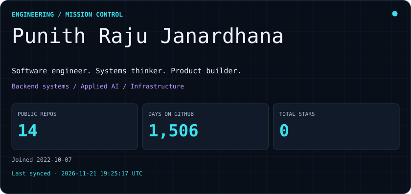
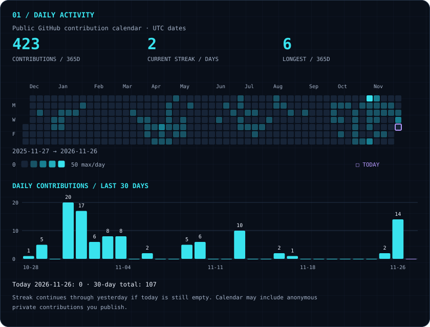
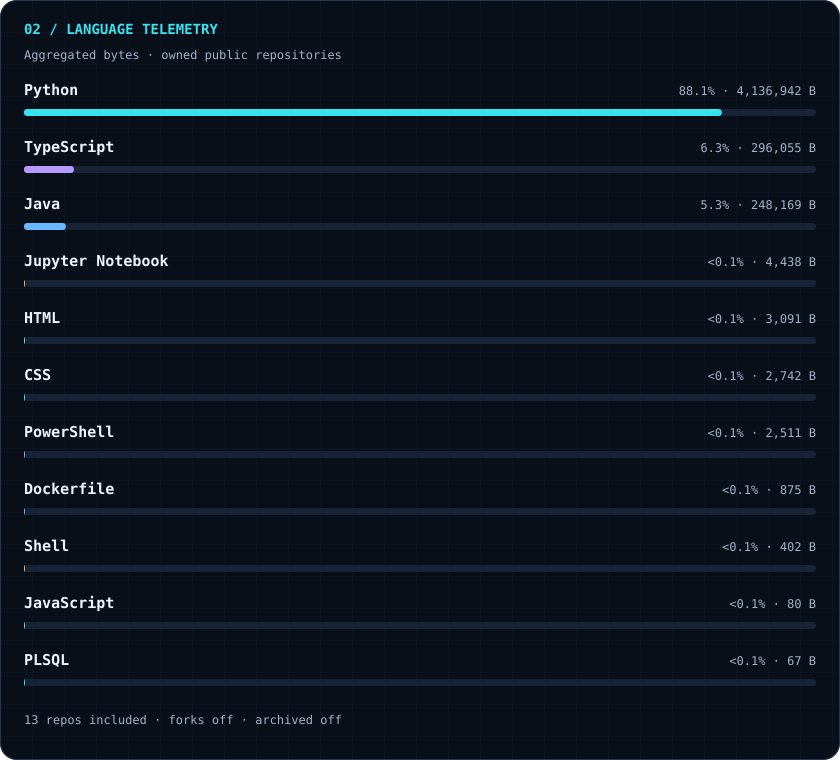
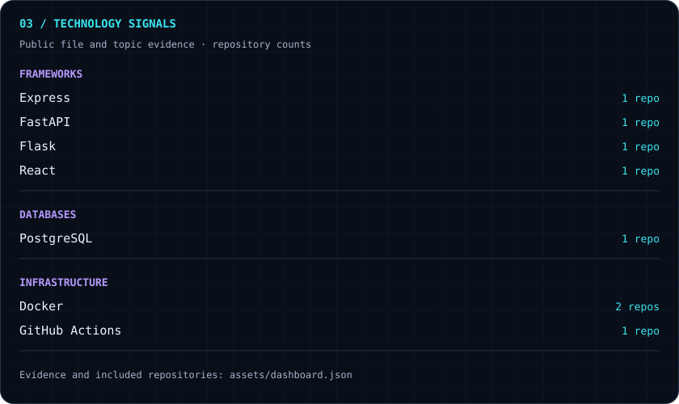
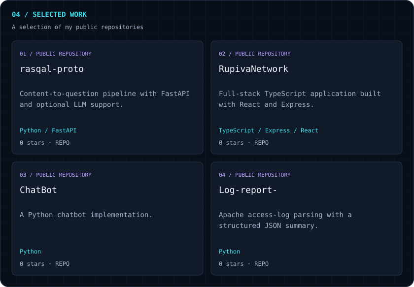
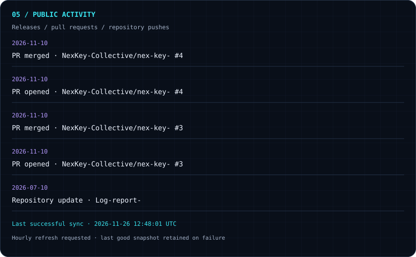

<!-- Generated by scripts/dashboard.py. Edit dashboard.config.json instead. -->

<picture>
  <source media="(max-width: 600px)" srcset="assets/overview-mobile.svg">
  
</picture>

[Portfolio](https://punithrajujanardhana.github.io/Portfolio/) · [Email](mailto:punithjanardhana@gmail.com)

[Explore selected work](#selected-work) · [Public activity](#public-activity) · [Data & setup](docs/SETUP.md)

## Daily activity

<picture>
  <source media="(max-width: 600px)" srcset="assets/activity-mobile.svg">
  
</picture>

## Languages & technologies

<picture>
  <source media="(max-width: 600px)" srcset="assets/languages-mobile.svg">
  
</picture>

<picture>
  <source media="(max-width: 600px)" srcset="assets/technologies-mobile.svg">
  
</picture>

Repository scope and data sources

Language and technology totals include **13 owned public repositories**. Forks: **False**. Archived: **False**. These filters do not change the public overview counts or featured selection.

[ChatBot](https://github.com/PunithRajuJanardhana/ChatBot), [Cryptocurrency-Data-Analysis](https://github.com/PunithRajuJanardhana/Cryptocurrency-Data-Analysis), [CSE360Project](https://github.com/PunithRajuJanardhana/CSE360Project), [data](https://github.com/PunithRajuJanardhana/data), [FacebookPagePipeline](https://github.com/PunithRajuJanardhana/FacebookPagePipeline), [fast-api-](https://github.com/PunithRajuJanardhana/fast-api-), [game](https://github.com/PunithRajuJanardhana/game), [Log-report-](https://github.com/PunithRajuJanardhana/Log-report-), [log-report-harbor-fix](https://github.com/PunithRajuJanardhana/log-report-harbor-fix), [PunithRajuJanardhana](https://github.com/PunithRajuJanardhana/PunithRajuJanardhana), [rasqal-proto](https://github.com/PunithRajuJanardhana/rasqal-proto), [RupivaNetwork](https://github.com/PunithRajuJanardhana/RupivaNetwork), [valo](https://github.com/PunithRajuJanardhana/valo).

Languages use GitHub language bytes, not skill ratings. Technology detection checks dependency manifests, topics and configuration paths; it is evidence of repository usage, not production deployment. Full file-level evidence and every daily count: [public data snapshot](assets/dashboard.json).

Contributions come from the **public GitHub contribution calendar**, which may include anonymous private contribution counts if enabled on the profile. No private repository metadata is fetched or published. Total and private repo counts stay masked to prevent subtraction. Stars cover all owned public repos. Dates are UTC; GitHub can delay contribution attribution.

## Selected work

<picture>
  <source media="(max-width: 600px)" srcset="assets/projects-mobile.svg">
  
</picture>

### [rasqal-proto](https://github.com/PunithRajuJanardhana/rasqal-proto)
Content-to-question pipeline with FastAPI and optional LLM support.

**Python / FastAPI** · 0 stars · [Repository](https://github.com/PunithRajuJanardhana/rasqal-proto)

### [RupivaNetwork](https://github.com/PunithRajuJanardhana/RupivaNetwork)
Full-stack TypeScript application built with React and Express.

**TypeScript / Express / React** · 0 stars · [Repository](https://github.com/PunithRajuJanardhana/RupivaNetwork)

### [ChatBot](https://github.com/PunithRajuJanardhana/ChatBot)
A Python chatbot implementation.

**Python** · 0 stars · [Repository](https://github.com/PunithRajuJanardhana/ChatBot)

### [Log-report-](https://github.com/PunithRajuJanardhana/Log-report-)
Apache access-log parsing with a structured JSON summary.

**Python** · 0 stars · [Repository](https://github.com/PunithRajuJanardhana/Log-report-)

## Public activity

<picture>
  <source media="(max-width: 600px)" srcset="assets/recent-mobile.svg">
  
</picture>

- **2026-11-10** — [PR merged · NexKey-Collective/nex-key- #4](https://github.com/NexKey-Collective/nex-key-/pull/4)
- **2026-11-10** — [PR opened · NexKey-Collective/nex-key- #4](https://github.com/NexKey-Collective/nex-key-/pull/4)
- **2026-11-10** — [PR merged · NexKey-Collective/nex-key- #3](https://github.com/NexKey-Collective/nex-key-/pull/3)
- **2026-11-10** — [PR opened · NexKey-Collective/nex-key- #3](https://github.com/NexKey-Collective/nex-key-/pull/3)
- **2026-07-10** — [Repository update · Log-report-](https://github.com/PunithRajuJanardhana/Log-report-)

Last successful sync: **2026-11-14 07:07:18 UTC** · [Refresh workflow](https://github.com/PunithRajuJanardhana/PunithRajuJanardhana/actions/workflows/dashboard.yml) · [Setup & configuration](docs/SETUP.md)
