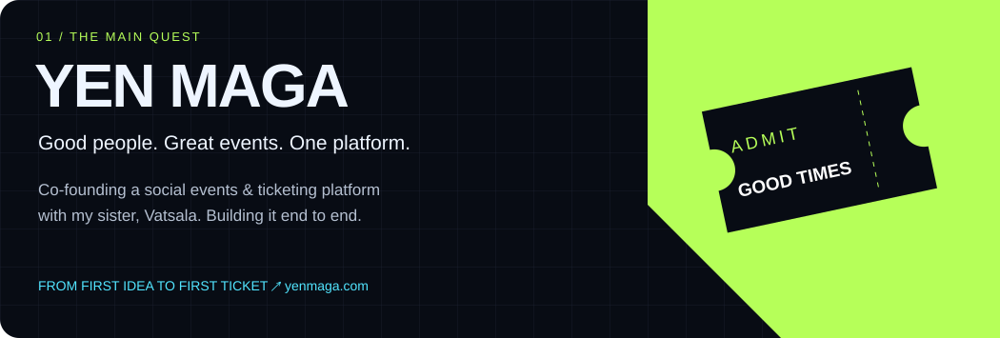
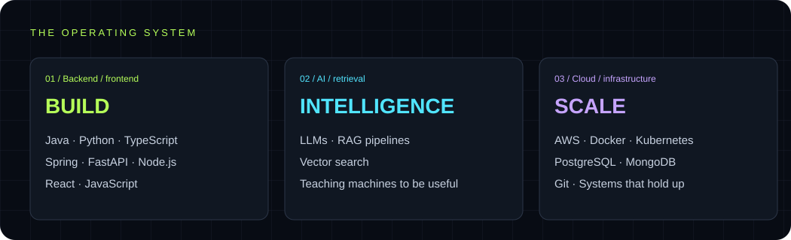

  

  
  
  

# Turning “what if” into shipped software.

I'm **Punith**, a Bengaluru boy based in **Seattle**. I build clean backends, explore LLMs and retrieval, and enjoy making systems scale. Most of my energy right now goes into **[Yen Maga](https://yenmaga.com/)** — and the people who will use it.

  

### The build behind the ticket

Shipping features. Talking to early users. Figuring out what makes an event platform **fun to use**, as well as functional. Building it end to end with my sister **Vatsala** is currently eating most of my free time — and I love every bit of it.

  

<strong>Open the toolbox / technologies in plain text</strong>

| Build | Intelligence | Scale |
| :--- | :--- | :--- |
| Java · Python · JavaScript · TypeScript | LLMs | AWS · Docker · Kubernetes |
| Spring · FastAPI · Node.js · React | RAG pipelines · Vector search | PostgreSQL · MongoDB · Git |

## Side quests / away from the keyboard

**The world is the next backlog.** Bengaluru roots, a growing travel list, and **2 / 196 countries** explored so far.

| Football | Cricket | Formula 1 | MotoGP | Basketball |
| :---: | :---: | :---: | :---: | :---: |
| Messi | Rohit Sharma | Lewis Hamilton | Valentino Rossi | Devin Booker |

  

  <a href="https://yenmaga.com/">Yen Maga</a> &nbsp; / &nbsp;
  <a href="https://punithrajujanardhana.github.io/Portfolio/">Portfolio</a> &nbsp; / &nbsp;
  <a href="https://www.linkedin.com/in/punith-raju-janardhana-8a2a431aa/">LinkedIn</a> &nbsp; / &nbsp;
  <a href="https://github.com/PunithRajuJanardhana">GitHub</a>

