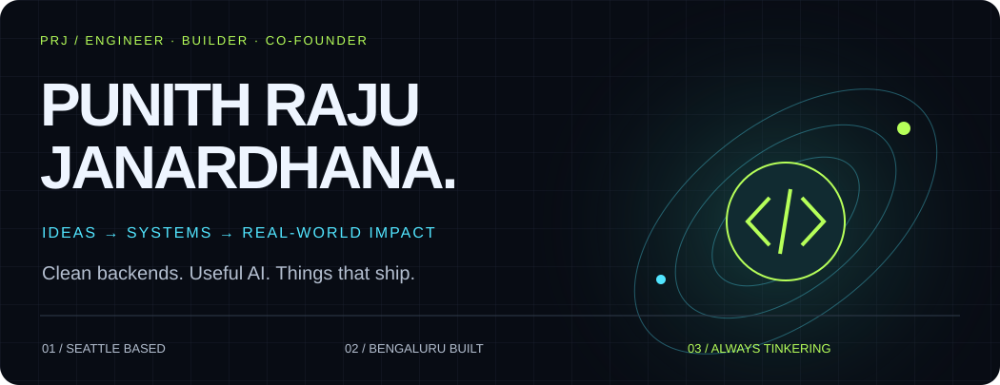

  

  
  
  

# Reliable systems. Useful products. Relentless curiosity.

I’m a **software engineer and product builder** drawn to reliable backends, useful AI, and products that make someone’s day a little easier.

My curiosity stretches beyond the code: **Who needs this? Why would they use it? What would make them come back?** I enjoy connecting those answers to the systems that bring a product to life.

## 🚀 What I’m building

### 🔐 Alksea · Current focus

Building **wallet compliance infrastructure** with a focus on backend security, auditability, and operational reliability. Going deeper into the engineering behind dependable systems — from permissions and recovery workflows to handling failures.

**[Explore Alksea ↗](http://alksea.com/)** &nbsp; · &nbsp; [Explore the code](https://github.com/PunithRajuJanardhana/Alksea)

## 💡 Other ventures · Currently paused

### 💸 Rupione

A lending platform designed to simplify credit access in India: **apply once, let lenders compete, and compare offers in one place.**

The idea brings together a universal application, consent-based document sharing, and transparent comparisons of rates, fees, and repayment terms for individuals and small businesses.

**[Explore Rupione ↗](https://rupione.com)**

### 🎟️ Yen Maga

Co-founding a social events and ticketing platform with my sister, **Vatsala**, to help people discover events worth showing up for. An opportunity to connect engineering, product design, and learning from early users.

**[Explore Yen Maga ↗](https://yenmaga.com/)**

## 🧩 Learning by building

My portfolio brings together my projects, experiments, and lessons from turning ideas into working software.

**Three Y Combinator rejections. Still curious. Still building.**

**[Explore my portfolio ↗](https://punithrajujanardhana.github.io/Portfolio/)**

## 🧠 Currently going deeper into

| Track | What I’m exploring |
| :--- | :--- |
| **01 / Applied AI** | LLM applications, RAG pipelines, and vector search |
| **02 / Backend engineering** | API design, system architecture, and reliability |
| **03 / CS fundamentals** | Data structures, algorithms, and LeetCode practice |
| **04 / Product thinking** | Consumer behavior, business models, and finding problems worth solving |

## 🛠️ My toolbox

<strong>Expand the full toolbox</strong>

| Area | Technologies |
| :--- | :--- |
| Languages | Java · Python · JavaScript · TypeScript |
| Backend | Spring · FastAPI · Node.js |
| Frontend | React |
| Databases | PostgreSQL · MongoDB |
| Cloud & tooling | AWS · Docker · Kubernetes · Git |

## 💭 How I build

**Understand the problem. Ship something useful. Learn from what happens.**

I value clear code, thoughtful interfaces, and systems people can depend on. I like moving quickly, asking questions, and revisiting assumptions when real feedback tells a different story.

Every project gives me a reason to strengthen the fundamentals and try something I haven’t done before.

## 🌍 Away from the keyboard

Usually following a match, a race, or an idea for the next trip.

| ⚽ Football | 🏏 Cricket | 🏎️ Formula 1 | 🏍️ MotoGP | 🏀 Basketball |
| :---: | :---: | :---: | :---: | :---: |
| **Messi** | **Rohit Sharma** | **Lewis Hamilton** | **Valentino Rossi** | **Devin Booker** |

Bengaluru will always be home. There’s plenty of the world left to see.

## 🤝 Find me here

Have an interesting problem, a product idea, or something you’re excited to build? **Let’s talk.**

  

  <strong><a href="https://punithrajujanardhana.github.io/Portfolio/">PORTFOLIO</a> &nbsp; / &nbsp; <a href="https://www.linkedin.com/in/punith-raju-janardhana-8a2a431aa/">LINKEDIN</a> &nbsp; / &nbsp; <a href="http://alksea.com/">ALKSEA</a> &nbsp; / &nbsp; <a href="https://yenmaga.com/">YEN MAGA</a> &nbsp; / &nbsp; <a href="mailto:punithjanardhana@gmail.com">EMAIL</a></strong>

